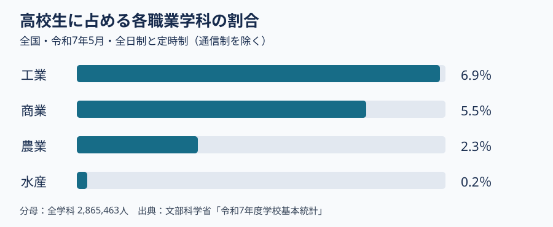

# 第4回の補足：農業・森林・水産を学校の学びとして読む

第4回の動画を見た後に読む補足資料です。**問いは「農業高校や水産高校という名前から、実際の授業をどこまで想像できるか」**です。以下の表は、全国の教科・科目の枠組みを示します。一つの学校が表中の全科目を開いているという意味ではありません。自分や家族の進路経験を書く必要はありません。

## まず、人数の表は何を数えているか

文部科学省の[高等学校学科別生徒数・学校数](https://www.mext.go.jp/a_menu/shotou/shinkou/genjyo/021201.htm)から、令和7年5月時点の全国の生徒数を抜き出しました。対象は**全日制・定時制の高等学校**で、通信制は含みません。割合の分母は、同表の全学科の生徒 **2,865,463人**です。卒業者数や就職者数ではありません。

| 学科の区分 | 生徒数 | 全学科の生徒に占める割合 |
|---|---:|---:|
| 工業 | 197,538人 | 6.9％ |
| 商業 | 157,989人 | 5.5％ |
| 農業 | 66,199人 | 2.3％ |
| 水産 | 7,003人 | 0.2％ |

ここでの「農業」「水産」は統計上の学科区分です。**森林・林業は農業科の専門科目として扱われる**ため、この表に「森林」の独立した人数はありません。また、水産科の人数が少ないことから「近くに学校がない」「就職先が少ない」とは結論できません。所在地、募集学科、通学の条件、卒業後の進路は別資料で確かめます。

## 教科と科目の違いを確かめる

「農業」「水産」は高校の専門教科の名前です。「農業と環境」「森林科学」「水産海洋基礎」などは、その教科に属する**科目**の名前です。中学校の進路相談で学校案内を見るときは、学校名から受ける印象と、学科が実際に設けている科目・実習を分けて読みます。

文部科学省の[農業編の学習指導要領解説](https://www.mext.go.jp/content/1407073_13_1_1_2.pdf)は、農業科の30科目を、共通の科目と四つの分野に整理しています。四つの分野には、作物や家畜などの生産・経営、食品の製造・流通、森林や農業土木などの国土保全・環境、地域資源の活用があります。「農業と環境」は導入となる科目、「課題研究」は複数の学びを使って課題に取り組む科目です（解説の「第1章 第4節」「第2章 第1節」）。

文部科学省の[水産編の学習指導要領解説](https://www.mext.go.jp/content/1407073_16_1_1_2.pdf)は、水産科に海洋漁業、海洋工学、情報通信、資源増殖、水産食品の五つの分野を想定しています。例えば「航海・計器」は船の運航、「船用機関」は船の機械、「資源増殖」は水産資源を増やし育てること、「食品管理」は水産食品の品質管理に関わる科目です。共通の導入科目「水産海洋基礎」では、海・水産物・船を入口にします（解説の「第1章 第4節」「第2章 第1節」）。

| 見る対象 | 農業科の例 | 水産科の例 | 工業科との接点を考える手がかり |
|---|---|---|---|
| 生物と環境 | 作物、森林科学 | 資源増殖、海洋環境 | 何を観察し、どの条件を記録するか |
| 食品 | 食品製造、食品流通 | 食品製造、食品管理 | 加工の方法と、品質を確かめる方法 |
| 機械・情報 | 農業機械、農業と情報 | 船用機関、海洋情報技術 | 機械を何に使い、何を制御・記録するか |

最後の列は**講義用の比較の問い**であり、科目の内容が三教科で同一という意味ではありません。例えば船用機関と工業科の機械に共通の技術があっても、船という使用環境や安全上の条件は異なります。科目名だけで授業内容を決めず、各校の教育課程表と実習案内に戻ります。

## 進路相談で使うなら、何を尋ねるか

架空の中学生が「生き物と機械の両方に関心がある」と話したとします。すぐに学科を一つ勧めず、次の順で学校案内を一校ずつ確認します。

1. **学ぶ対象**：作物、森林、魚介類、船、食品のうち、何を扱う科目・実習があるか。
2. **活動の条件**：実習場所、設備、安全指導、通学、費用など、本人が参加する際に必要な条件は何か。
3. **卒業後の経路**：就職先や進学先の実例は何年の、何人を対象にした情報か。希望者だけの割合か、卒業者全員を分母にした割合か。

学校の広報写真は活動の例を示しますが、写っている実習を全員が必ず行う証拠にはなりません。「水産科なら漁師」「農業科なら農家」と決めつけず、授業・資格・進路を別々に確かめます。

## 考える時間（提出不要、5分程度）

上の表から、農業科と水産科で**名前が同じ科目を一つ**、扱う対象が異なる科目を一つ選びます。共通点と相違点をそれぞれ一文で書き、学校案内で追加確認したい項目を一つ挙げます。

**説明例**：「食品製造」は両方の教科にあります。ただし原料や加工・保存の条件は同じとは限りません。「森林科学」と「海洋環境」は調べる環境が異なります。入学前には、志望校の科目配置と実習の内容を確認します。

## 出典と更新時の確認

- [文部科学省「高等学校学科別生徒数・学校数」（令和7年5月）](https://www.mext.go.jp/a_menu/shotou/shinkou/genjyo/021201.htm)：人数・割合・集計対象。図と表は同ページの数値から講義用に作成。
- [文部科学省「高等学校学習指導要領（平成30年告示）解説 農業編」](https://www.mext.go.jp/content/1407073_13_1_1_2.pdf)：第1章第4節の科目・分野構成、第2章第1節「農業と環境」。
- [文部科学省「高等学校学習指導要領（平成30年告示）解説 水産編」](https://www.mext.go.jp/content/1407073_16_1_1_2.pdf)：第1章第4節の科目・分野構成、第2章第1節「水産海洋基礎」。

この資料は2026年11月6日に上記の公開資料を確認して作成しました。学校ごとの開講科目・募集・進路は年度によって変わるため、進路相談では志望年度の学校案内を確認します。
