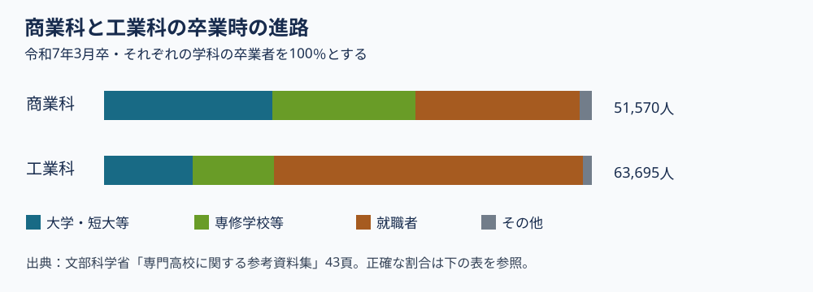

# 第5回の補足：商業科の学びを、科目と進路の資料から読む

第5回の動画を見た後に読む資料です。**問いは「商業高校で学ぶ『情報』は何を扱い、工業高校の情報の学びとどうつながるか」**です。科目名と卒業時の進路を確かめ、中学校の進路相談で聞くべきことを考えます。動画の販売計算をもう一度解く必要はありません。

## 商業科は「販売だけ」を学ぶ教科か

文部科学省の[高等学校学習指導要領解説・商業編](https://www.mext.go.jp/content/1407073_15_1_1_2.pdf)では、商業科の科目を、マーケティング、マネジメント、会計、ビジネス情報の四つの分野などに整理しています。**教科**は「商業」、**科目**は「簿記」「情報処理」など、授業の名前です。科目が示されていても、各学校が全科目を開講するという意味ではありません。

| 分野 | 科目の例 | 授業で問うことの例 |
|---|---|---|
| マーケティング | マーケティング、商品開発と流通 | 誰に、何を、どう届けるか。予想と実際の売れ方はどう違うか。 |
| マネジメント | ビジネス・マネジメント、ビジネス法規 | 人・資金・情報などをどのように使い、どのルールを確かめるか。 |
| 会計 | 簿記、原価計算 | 取引や費用をどう記録し、数字から何を判断できるか。 |
| ビジネス情報 | 情報処理、プログラミング、ネットワーク活用 | 売上や在庫などの情報をどう整理・分析し、安全に扱うか。 |

右端は講義用の具体的な問いです。学習指導要領の文言をそのまま写したものではありません。商業科の「ビジネス基礎」と「課題研究」は、原則として商業に関する各学科の生徒が履修する科目です。「原則として」は学校に例外があり得るという意味なので、志望校の教育課程表で実際の配置を確認します（解説・商業編、第1章第4節、第5章第4節）。

## 同じ「情報」でも、何のために使うか

商業科の「情報処理」は、企業で使う情報を集め、処理し、分析して伝えることを扱います。情報セキュリティや知的財産にも注意を払います（[商業編・第2章第16節](https://www.mext.go.jp/content/1407073_15_1_1_2.pdf)）。例えば学校の模擬販売なら、売れた数量だけでなく、時間帯、価格、仕入れ数などを記録し、次の発注量を考えます。

工業科の「工業情報数理」は、工業で用いるプログラミング、計算、計測・制御などを扱います（[工業編・第2章第5節](https://www.mext.go.jp/content/20251203-mxt_kyoiku01-100002620_23.pdf)）。例えば温度センサーの値を読み、機械を制御する手順を考えます。**どちらも情報を扱いますが、取り上げる仕事上の問いが違います。** もちろん工業の学習でも生産費用や販売を考え、商業の学習でもプログラムを作れます。ここでは科目の主な入口を比較しています。

高校生が共通に学ぶ「情報Ⅰ」と、商業科の専門科目「情報処理」も、名前と役割が異なります。商業編の解説は、目標や内容が重なる場合に専門科目で「情報Ⅰ」の履修を代替する例を示していますが、**科目名だけで自動的に代替されるわけではありません**。学校の教育課程表で、共通教科と専門教科の科目がどう組み合わされているかを確認します（商業編・第5章第5節「必履修教科・科目との代替」）。

| 活動の例 | 入力する情報 | 確かめたい判断 | 誤りがあると困ること |
|---|---|---|---|
| 模擬販売の在庫管理 | 販売数、残りの数、仕入れ数 | 次に何個仕入れるか | 売り切れや余剰、記録の間違い |
| 温度に応じた機械の制御 | センサーの値、設定温度 | いつ機械を動かすか | 動作の遅れ、誤動作、安全への影響 |

この表は説明用の架空例で、学校の授業実態を示す統計ではありません。生成AIで広告文や集計の説明を作る場合も、入力したデータ、商品の事実、計算過程、表現の妥当性は人が確認します。「AIを使った」ことだけでは、学習内容や判断の正しさは分かりません。

## 卒業時の進路をどう読むか

文部科学省の[専門高校に関する参考資料集（2026年2月、43頁）](https://www.mext.go.jp/content/20260220-mxt_koukou02-000047408_15.pdf)には、令和7年3月卒業者の学科別進路が載っています。下の図は、そのうち商業科と工業科を講義用に描き直したものです。**一行が卒業者全員を100％とする構成比**で、就職希望者に限った「就職率」ではありません。図は進路の種類を示し、仕事の質や本人の満足度を示しません。

| 令和7年3月卒 | 卒業者数 | 大学・短大等 | 専修学校・公共職業能力開発施設等 | 就職者 | その他 |
|---|---:|---:|---:|---:|---:|
| 商業科 | 51,570人 | 34.5％ | 29.3％ | 33.6％ | 2.6％ |
| 工業科 | 63,695人 | 18.2％ | 16.6％ | 63.3％ | 1.9％ |

商業科の大学・短大等への進学割合は工業科より高く、工業科の就職者の割合は商業科より高い、と**この年の卒業者について**言えます。しかし、特定の生徒にどちらの学校が向くかは、この集計だけでは決まりません。各校の進路は学科の内訳、地域、希望者数によって異なります。また就職進学者はこの表の就職者に含まれません。進路相談では、志望年度に近い学校別資料の対象年・人数・進路先を確かめます。

## 考える時間（提出不要、5分程度）

架空の中学生が「パソコンを使う仕事に興味がある」と言いました。上の二つの活動例から、**もう一つ聞きたいことを一問**作ってください。次に、進路の図から商業科と工業科で違いがある数字を一つ選び、「何を分母にした割合か」を付けて説明してください。

**説明例**：「販売数や在庫を見て発注を考えることと、センサーを使って機械を動かすことのどちらに関心がありますか」と尋ねます。商業科の大学・短大等への進学34.5％は、令和7年3月の商業科卒業者51,570人を分母にした割合です。これは本人の進学可能性を表す数字ではありません。

## 出典と更新時の確認

- [文部科学省「高等学校学習指導要領（平成30年告示）解説 商業編」](https://www.mext.go.jp/content/1407073_15_1_1_2.pdf)：第1章第4節の分野・科目構成、第2章第16節「情報処理」、第5章第4節の原則履修科目。
- [文部科学省「高等学校学習指導要領解説 工業編」](https://www.mext.go.jp/content/20251203-mxt_kyoiku01-100002620_23.pdf)：第2章第5節「工業情報数理」。
- [文部科学省「専門高校に関する参考資料集」（2026年2月、43頁）](https://www.mext.go.jp/content/20260220-mxt_koukou02-000047408_15.pdf)：令和7年3月卒業者の学科別進路。図と表は同資料の数値から講義用に作成。

この資料は2026年11月6日に上記の公開資料を確認して作成しました。統計の年度と学校ごとの教育課程・進路は、利用時に改めて確認します。
