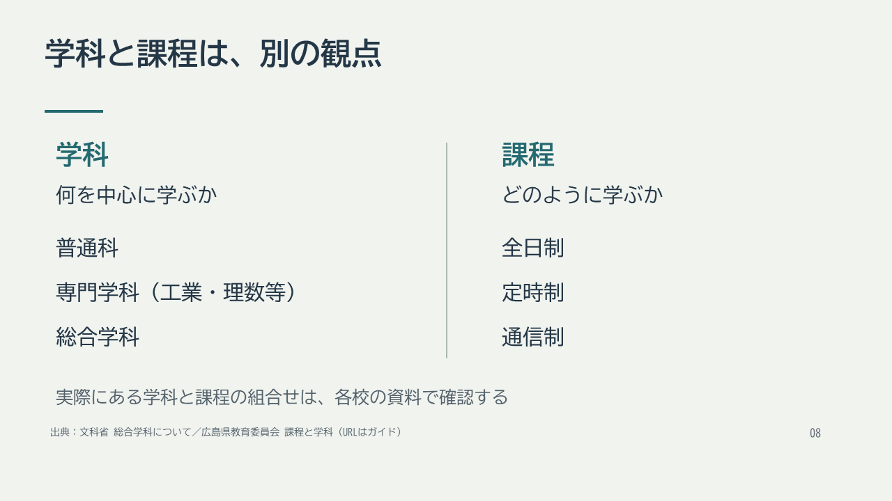

# スライド・動画の共通配色

2026年11月4日改訂。Ⅰ・Ⅱのスライド全30回（858枚）と、Ⅱ第1回の動画用スライド32枚に適用します。今後の増補・動画制作でも同じ配色を用います。

長時間の視聴を考え、広い白地を淡い灰緑に変更しました。本文は濃い青灰、強調は落ち着いた青緑とし、背景を暗くするだけで文字の明暗差を失わないようにします。表と図の内容、文字サイズ、配置は維持しています。

| 用途 | 色 |
|---|---|
| 通常の背景 | `#F1F3EF` |
| 思考・休止の背景 | `#E5ECE7` |
| 本文・見出し | `#243746` |
| 強調文字 | `#246A70` |
| 出典・ページ表示 | `#52616A` |
| 表の見出し・字幕帯 | `#344B53` |
| 表の見出し・字幕の文字 | `#F1F3EF` |
| 表の交互行 | `#E2E8E5` |

本文と通常背景の明暗比は約11.0、強調文字は約5.6、表見出しと字幕は約8.3です。色だけで区別せず、見出し・文字・区切り線を併用します。動画の冒頭も通常画面と同じ背景色にそろえ、切り替えによる大きな明るさの差を避けます。字幕は本文と重ならない専用帯に表示します。

## 更新の範囲

スライドはPPTXとPDFを同じ配色で更新しています。動画は制作済みのⅡ第1回を更新し、Nanami（Natural）の音声、字幕の文面と時刻、章構成を引き継ぎます。今後の動画もこの配色を基本とします。

内容70分＋思考・休止20分への増補は[改訂方針](revision-plan.md)に沿って別途進めます。配色変更によって、授業時間を確認済みとは扱いません。

## 表示例

