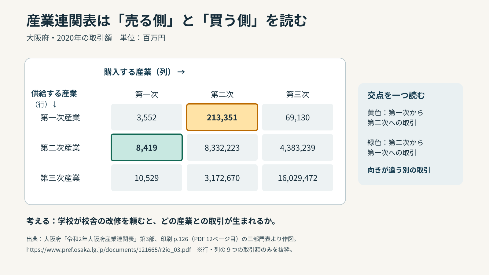
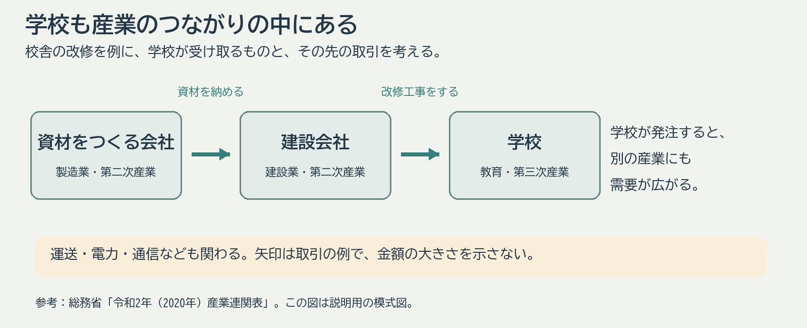
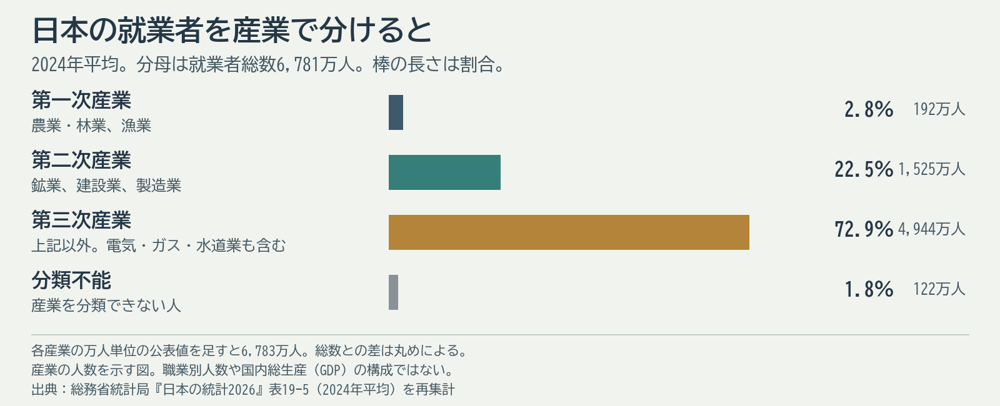

# 第1回 社会・産業・仕事と職業教育の基礎

2026年11月6日・導入と表の説明を改訂。再編案の回番号です。

## 到達目標

- 産業と職業、就業者と雇用者、三つの産業部門を区別できる。
- キャリア教育・職業教育・進路指導の役割を、仕事の例と関係付けられる。

## まず、この回の見取り図

パンが店に並ぶまでには、育てる、作る、運ぶ、売る活動があります。この回では事業の種類を表す「産業」と、一人ひとりの仕事を表す「職業」を分けます。三つの産業部門と学校とのつながりを見て、進路を考える生徒を学校がどう支えるかへ進みます。

最初の表は三つの産業部門を身近な活動に結び付ける説明用の表です。後半の棒グラフは各部門で働く人の割合を示します。この二つは示す内容が違います。まず例から部門の意味をつかみ、その後に人数の図を読みます。

## 言葉を使って確かめる

**産業と職業**　食品工場で設備を直す人がいます。工場の事業と、その人の仕事はどう分けて説明できますか。

**答え**　工場の事業は食品の製造です。その人は設備の保守を担当します。何を作る事業かと、そこで何をする仕事かを分けます。

## 産業と職業とキャリア教育

産業は事業所などが行う経済活動、職業は人が担う仕事の種類に注目した分類です。食品工場の設備保全、会計、販売企画は同じ産業内にもある異なる職業の例です。「産業セクター」は、産業を大まかに分けた部門という意味です。初めは、身近なパンが店に届くまでを思い浮かべてください。

次の表では、三つの部門を「パンが届くまでの例」と「ほかの例」で比べます。左列は部門の名前、中央列はパンに関わる例、右列はパン以外の例です。人数や産業の大きさを示す表ではありません。三行を一度に見て、原料を育てる、加工する、運んで売る活動がどこに入るか確かめます。

| 大まかな部門 | パンが届くまでの例 | ほかの例 |
|---|---|---|
| 第一次産業 | 小麦を育てる | 林業・漁業 |
| 第二次産業 | 小麦粉やパンを製造する | 建設業・鉱業 |
| 第三次産業 | 店で販売する、運ぶ | 医療・福祉、情報通信、電気の供給 |

この三つは会社の事業を分けるための大まかな地図です。パン一個にも複数の部門が関わります。工業高校の学びも製造業だけで使うわけではありません。たとえば電気を供給する会社は第三次産業に数えられますが、設備を点検する技術者がいます。実際の統計では、どの事業をどの部門に入れるか、分類できないものをどう扱うかを注記で確認します。

就業者には、雇われて働く人のほか、自分で事業を営む人なども含まれます。例えば、自分でパン店を営む人と、その店に雇われて販売を担当する人は、ともに働いています。雇われて働く人を数える表なら、店主と販売を担当する人は扱いが異なります。産業別の割合を読むときは、表の題名や注記から「誰を全部で何人と数えたか」を確かめます。人数の割合と生産額の割合を比べるときは、何の大きさを表す数字かも見ます。

職業教育は特定の職業分野で必要となる知識・技術等を育て、キャリア教育は社会的・職業的に自立する基盤を育てます。進路指導では生徒が学びや将来の選択を考え、決定し、その後も見直せるよう支えます。職業教育、キャリア教育、進路指導は互いに関係します。生徒に職業名を早く一つ決めさせることだけを目指すわけではありません。[文部科学省 キャリア教育の手引き、2023年、第1章](https://www.mext.go.jp/a_menu/shotou/career/detail/mext_00010.html)

## 仕事で使う知識を確かめる

集まりでお菓子を72個用意するとします。1袋に12個入っていれば、必要なのは6袋です。注文画面で「袋」と「個」を読み違えると、必要な量がそろいません。店や工場で注文を受けるときも同じです。数字が何を数えたものかを理解し、分からないところは商品の説明や注文票を確かめることが、仕事の判断につながります。

## 食品が届くまでの産業と仕事

パンが店に届くまでには、原料をつくる、加工する、品質を確かめる、運ぶ、販売するといった活動があります。産業は事業の種類、職業は人が従事する仕事の種類として分けると、食品製造業の企業にも設備保全や経理の仕事があると分かります。

## 産業は一方向だけにつながらない

「原料をつくる→加工する→売る」は入口として便利ですが、実際のつながりは一方向だけではありません。小麦を育てる農家も、製造業がつくる農機や肥料を使い、電気や運送のサービスを利用します。パン工場も農産物、機械、電力、配送を必要とします。農業や製造業などの各産業は、ほかの産業から品物やサービスを買い、ほかの産業へも販売します。この売り買いを産業間のつながりとして見ていきます。

産業連関表を説明する前に、[大阪府の公式解説書（PDF）](https://www.pref.osaka.lg.jp/documents/121665/r2io_03.pdf)をダウンロードし、印刷されたページ番号126（PDFの12ページ目）を開いてください。ダウンロードが難しい場合は、この後のスライドの表を見れば進められます。公式解説書は、大阪府の2020年の取引を第一次・第二次・第三次産業にまとめた表を載せています。まず表の形を見て、行と列に産業名が並んでいることを確認します。

| 供給する産業＼購入する産業 | 第一次産業 | 第二次産業 | 第三次産業 |
|---|---:|---:|---:|
| 第一次産業 | 3,552 | 213,351 | 69,130 |
| 第二次産業 | 8,419 | 8,332,223 | 4,383,239 |
| 第三次産業 | 10,529 | 3,172,670 | 16,029,472 |

大阪府の産業連関表では、「第一次産業」の行と「第二次産業」の列が交わる213,351が、第一次産業から第二次産業への取引額です。行と列を逆にすると8,419になり、第二次産業から第一次産業への取引額を示します。売る側と買う側を入れ替えると、別の取引になります。この回では金額の計算は求めません。

一方、後で見る2024年の就業者の図は、各産業で働く人の人数を表します。大阪府の産業連関表の金額と、全国の就業者数は、地域も年も単位も違います。それぞれの資料から分かることを分けて読みます。

## 学校と産業のつながり

学校もほかの産業から品物やサービスを買います。学校の事業は教育で、三つの産業部門では第三次産業に入ります。校舎には建設や設備保全の仕事が関わり、授業には電力、通信、教材、給食、清掃などが必要です。学校で働く人にも教員、事務職員、設備を管理する人など、異なる職業があります。生徒は卒業後、さまざまな分野で学び、働きます。生徒を「製品」や「学校の生産額」とみなす説明ではなく、教育と社会の相互の関係として捉えます。

たとえば学校が校舎の改修を発注すると、建設会社は資材を購入し、資材をつくる会社は原料や電力を使います。運送も必要です。最初の発注に伴って別の産業にも需要が広がることを「経済波及効果」と呼びます。ただし、この例は道筋を示すだけです。金額や地域内に残る額は、取引の実数と計算条件を確かめなければ言えません。

| 学校と他の部門のつながり | 身近な例 |
|---|---|
| 学校が受け取るもの | 校舎の工事、電力、通信、教科書や実習材料 |
| 学校が行うこと | 教育、進路相談、地域との活動 |
| 卒業後に広がる道 | 進学、就職、学び直しなど複数の経路 |

## 学校で学ぶ内容との接点

産業別就業者のグラフは、年・単位・集計の対象を確かめて読みます。食品が届く過程をたどると、大きな産業分類に隠れている仕事が見えてきます。たとえば電気を供給する会社は、この授業で使う三つの産業部門では第三次産業に入ります。同じ会社でも発電設備の点検、事務、営業など職業は分かれます。工業高校で学んだ人の働く先を第二次産業だけに限って考えないための例です。

| 活動 | 学校で学ぶ内容との接点 |
|---|---|
| 原料の生産 | 栽培・生産管理 |
| 加工と品質確認 | 設備・測定・衛生 |
| 流通と販売 | 物流・会計・情報活用 |

## 図の読み取り

2024年平均の就業者総数は6,781万人です。図の割合は各部門の就業者数をこの総数で割った概算です。第三次産業の72.9％は「就業者のうち、この集約に入る産業で働く人の割合」を表します。仕事の重要さや生産額、学校で学ぶ内容の比率ではありません。

| 区分 | 就業者（万人） | 構成比 |
|---|---:|---:|
| 第一次産業 | 192 | 2.8％ |
| 第二次産業 | 1,525 | 22.5％ |
| 第三次産業 | 4,944 | 72.9％ |
| 分類不能 | 122 | 1.8％ |

集約方法は、第一次＝農業・林業と漁業、第二次＝鉱業・建設業・製造業、第三次＝それ以外の分類可能な産業です。電気・ガス・熱供給・水道業も第三次に含めました。これは講義用の集約で、原表に「第一次～第三次」の行があるわけではありません。各産業の公表値は万人単位に丸められているため、内訳の合計6,783万人は総数6,781万人と一致しません。割合を足して厳密な人数に戻すことはできません。

この図だけでは、第三次産業の中にどの職業が何人いるか、工業高校出身者がどこに就職したか、産業ごとの売上・生産額がどれだけかは分かりません。産業別の表と職業別の表は別です。総務省統計局『日本の統計2026』の表19-4と表19-5を見比べ、表題に「産業」と「職業」のどちらがあるか確かめます。

## 考える時間

学校が校舎の改修を発注したとします。学校から建設会社、その先の産業へ需要が広がる道筋を、矢印を二本以上使って短く描いてください。学校の「産業」と、工事に関わる一人の「職業」を区別します。最後に、就業者の図だけでは波及する金額を計算できない理由を一つ示してください。

**説明例**　学校（教育、第三次産業）→建設会社（改修工事、第二次産業）→資材をつくる会社（製造業、第二次産業）という道筋が考えられます。建設会社から運送業（第三次産業）へもつながります。工事で配線を担当する電気工事士は職業の例です。就業者の図は各産業で働く人数を示します。学校や建設会社がいくら発注し、そのうちいくらが別の産業へ回るかは分からないため、波及額は計算できません。

提出不要のメモです。架空例または公開資料で取り組めます。

## 参考文献・資料

- 2024年平均の産業別就業者数の原表と、比較用の職業別表。刊行年・データ年・就業者の分母を区別。 [総務省統計局『日本の統計2026』第19章、表19-4・19-5](https://www.stat.go.jp/data/nihon/19.html)
- 商品開発と販売実習で、担当する作業を読む。 [農林水産省 農高生の活動写真](https://www.maff.go.jp/j/pr/aff/2307/spe1_03.html)
- 産業間の品物・サービスの取引をまとめた表の入口。就業者数の図とは測っているものと年が異なる。 [総務省・令和2年（2020年）産業連関表の概要](https://www.e-stat.go.jp/stat-search/files?cycle=0&layout=datalist&month=0&page=1&stat_infid=000040185040&tclass1val=0&toukei=00200603&tstat=000001218140&year=20200)
- 第一次・第二次・第三次産業間の実際の取引額を示す表。印刷p.126（PDFの12ページ目）。 [大阪府『令和2年大阪府産業連関表』第3部](https://www.pref.osaka.lg.jp/documents/121665/r2io_03.pdf)
- 詳しい13部門表を確認したい場合の入手先。授業では計算しない。 [大阪府「01 取引基本表13部門」CSV](https://www.pref.osaka.lg.jp/documents/121666/r02k_01_kihon_seisan_13.csv)
- 進路選択だけに限らないキャリア教育と、中学校段階の支援。 [文部科学省 中学校・高等学校キャリア教育の手引き（2023年3月）](https://www.mext.go.jp/a_menu/shotou/career/detail/mext_00010.html)

[詳しい説明原稿](../ii-01-explanation.md)

[各回の教材一覧](README.md)／[現行教材との対応と更新状況](../../../docs/lesson-quality-review.md)

[本編スライド・学生用ガイド・動画](../main/01/README.md)
