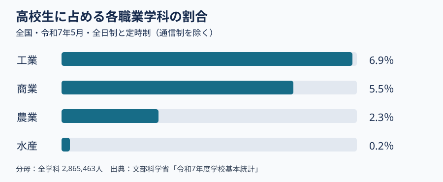

# 第4回 農林水産・食品・環境の学びとキャリア

2026年11月6日・本文改訂版。再編案の回番号です。用語と理由の説明、具体例、考える時間の順に読みます。

## この回で確かめること

工業科教育論Ⅱの第4回です。農林水産や食品、環境の専門学科を、高校教育全体の中で見ます。どのような実習と仕事があるかを知り、工業の学びと共通する点や異なる点を考えます。

## 到達目標

- 農業・森林・水産海洋の学びが、生産だけでなく加工・情報・環境等へ広がることを説明できる。
- 分野を一つ選び、学ぶ活動と卒業後の確認事項を対応させられる。

## 言葉を使って確かめる

**読む手がかり**　流通。品物が作られた場所から使う人に届くまでの流れです。運ぶ、保管する、売る仕事が関わります。

**加工と流通**　魚を冷凍品にする工程と、冷凍品を店へ運ぶ工程はどう違いますか。

**答え**　冷凍品にするのは加工、店へ運んで届くようにするのは流通に関わる仕事です。

## 農林水産を生産から情報と環境まで見る

### 第1節　何を学ぶ学校か

「農業高校」という名前から、作物を育てる授業だけを想像するかもしれません。農業科には食品の製造、森林の管理、農業機械の利用などもあります。例えば果物を育てる作業と、収穫した果物を加工する作業では、学ぶ技術が違います。「森林科学」は農業科の科目名です。後で読む統計に「森林」という独立した学科の欄がなくても、森林を学ぶ生徒がいないという意味ではありません。

### 第2節　教科・科目・学科を分ける

**教科**は授業内容の大きなまとまりで、「農業」「水産」などが例です。**科目**は教科の中の一つ一つの授業で、「森林科学」「水産海洋基礎」などが例です。**学科**は学校に設ける学びのコースです。国の学習指導要領に科目名があっても、一つの学校がその科目をすべて開いているわけではありません。志望校の教育課程表で、どの学年に何を学ぶかを確かめます。

農業科と水産科の両方に「食品製造」という科目があります。ただし、果物と魚介類では原料の性質や保存の条件が異なります。また、農業機械と船用機関はどちらも機械に関わりますが、畑と船では使う場所も安全上の条件も異なります。科目名が同じ、または似ているだけで授業の中身を決めず、各校の実習案内を見ます。

### 第3節　全国の人数の図を読む

[文部科学省の令和7年5月の表](https://www.mext.go.jp/a_menu/shotou/shinkou/genjyo/021201.htm)は、全国の**全日制・定時制**の高校生を数えています。通信制の生徒は含みません。全学科の生徒2,865,463人を100％とすると、工業科は197,538人（6.9％）、農業科は66,199人（2.3％）、水産科は7,003人（0.2％）です。これは在校生の人数であり、卒業者数や就職者数ではありません。

水産科の全国の人数が農業科より少ないことは分かります。一方、この表だけでは、地元に通える水産科があるか、卒業後の仕事がどのくらいあるかは分かりません。学校の所在地、募集学科、進路実績をそれぞれ別に調べます。

### 第4節　進路相談で学校案内を読む

志望校の案内では、まず実際に開く科目と実習を見ます。次に通学、費用、実習の安全上の条件を確かめます。卒業後の進路の割合を見るときは、何年の何人を対象にした数字かを確認します。学校の広報写真は活動の一例であり、全員がその活動をする証拠ではありません。

農業の専門教育には、作物や家畜の生産に加え、食品加工、流通、環境、森林などの学びがあります。森林を学ぶ場面でも、木材を利用することと、森林の状態を調べ管理することはつながります。名称だけで昔の仕事のイメージに結び付けず、現在の教育課程と活動を読みます。

水産・海洋の分野には、資源を扱う学び、養殖、食品、船舶、海洋環境、情報技術などがあります。全ての学校が同じ設備や実習をもつわけではありません。食品を共通の題材にするなら、農業と水産で原料や管理する環境がどう異なり、加工・品質・情報の扱いがどう共通するかを比較できます。

中学校の理科で生物や水質に関心をもった生徒には、その関心が農業・水産・工業の化学分野などへ広がることを示せます。どの学科がよいかを名称だけで決めず、実習の対象、学ぶ科目、通学や実習の条件、卒業後の経路を同じ項目で比べます。写真は活動を知る入口として用い、写った活動を全生徒が必ず経験するとは扱いません。

## 生産・加工・環境を学ぶ専門高校

農業、森林、水産では、扱う資源と現場が異なります。食品という共通の題材から、原料の生産、環境の管理、加工や表示へ学びを広げられます。学校案内の写真を見るときは、活動と学科名を本文で確かめます。

水産高校の公開事例には養殖施設や食品の実験実習があり、農業高校の公開事例には地域の食材を使う商品開発があります。興味のある活動がどの学科のどの授業で経験できるか、各校の教育課程へ戻って確認します。

| 分野 | 学習活動の例 |
|---|---|
| 農業・食品 | 原料を育て、加工を試す |
| 森林・環境 | 森林の状態や資源利用を調べる |
| 水産・海洋 | 養殖環境を管理し、食品を扱う |

## 考える時間

本文の二つの例を比べます。農業高校で地域の食材を使って商品を考える活動と、水産高校で養殖環境を調べる活動について、それぞれ「何を扱うか」「どんな作業か」を表から書き出します。その学びを卒業後につなげて考えるため、学校案内でさらに確かめたいことを一つ挙げます。

**説明例**　農業の例では地域の食材と商品づくり、水産の例では養殖する生物と環境の管理を扱います。学校案内では、活動がどの学科・科目で行われるかを確認します。卒業後の進路は別の欄で年度と対象を確かめます。

提出不要のメモです。架空例または公開資料で取り組めます。

## 参考文献・資料

- 商品開発と販売実習で、担当する作業を読む。 [農林水産省 農高生の活動写真](https://www.maff.go.jp/j/pr/aff/2307/spe1_03.html)
- 養殖施設や食品の実験実習。 [農林水産省 水産高校の施設・実習写真](https://www.maff.go.jp/j/pr/aff/2207/spe1_02.html)
- 掲載時点の森林・林業に関わる高校一覧。 [林野庁 森林・林業関係高校一覧 2024年4月](https://www.rinya.maff.go.jp/j/ken_sidou/fukyuu/attach/pdf/230329-1.pdf)

[各回の教材一覧](README.md)／[現行教材との対応と更新状況](../../../docs/lesson-quality-review.md)

[本編スライド・学生用ガイド・動画](../main/04/README.md)
