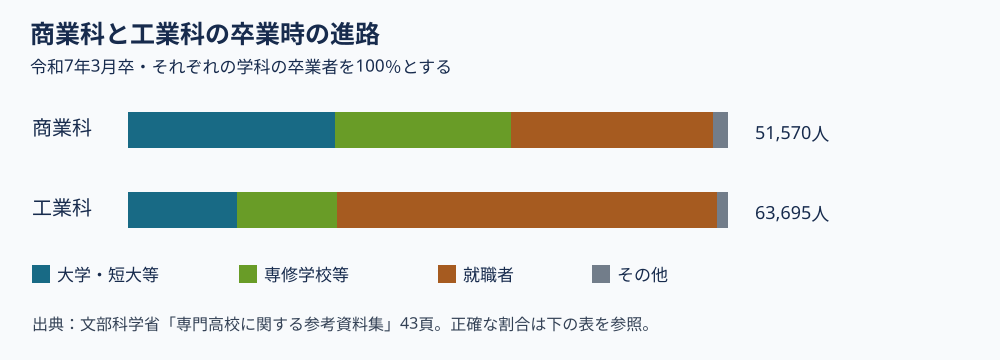

# 第5回 商業・ビジネス・情報の学びとキャリア

2026年11月6日・本文改訂版。再編案の回番号です。用語と理由の説明、具体例、考える時間の順に読みます。

商業の学びを、高校の専門学科を知るための比較例として扱います。工業高校にもある情報活用や実習・課題研究と照らし、学ぶ対象と判断に使う記録がどう違うかを確かめます。

## この回で確かめること

工業科教育論Ⅱの第5回です。商業高校では、販売、会計、情報をどのように学ぶのでしょうか。身近な取引の数字から売上と利益を区別し、工業高校との学びの接点を考えます。

## 到達目標

- 会計・流通・販売・情報等の学習内容の違いを説明できる。
- 情報技術やAIを使う活動でも、根拠と判断の役割を示せる。

## 言葉を使って確かめる

**売上と利益**　架空の販売で売上が1万円、費用の合計が7千円でした。この例の利益はいくらですか。

**答え**　利益は3千円です。売上は販売で得た金額で、この例ではそこから費用を差し引きます。

## 第1節　売上・費用・利益を区別する

商業では、商品の売り方を考えるマーケティング、取引を記録する会計、企業活動を支える情報の活用などを学びます。販売実習はそれらを関連付ける一つの場面です。売上は販売によって得た金額であり、費用を考慮した利益とは区別します。

架空の販売で、100個を1個200円で売れば売上は2万円です。仕入れが1個120円なら仕入額は1万2000円で、その差は8000円です。ここから会場費や包装費なども考慮する必要があるため、8000円を最終的な利益と決め付けません。会計の記録は、判断に必要な条件を明らかにする役割があります。

AIで広告案を作る場合にも、商品の事実、対象とする客、根拠のない効能や誇張がないかを人が確かめます。「よく売れた」ことに加え、なぜ価格を決めたか、予測と結果の違いをどう捉えたかを学習の記録にします。受講者は販売やAI操作を実行せず、この架空記録の説明を考えれば取り組めます。

## 第2節　商業科の四分野と販売の記録を読む

架空の販売実習で、来客が多く売上が伸びたとします。企画の学びを確かめるには、原価をどう見積もり、どの客を想定し、売場や説明をどう調整したかも読みます。

会計、情報、商品企画は互いにつながっています。売上の数字と、予測・記録・振り返りを並べると、販売の条件と、生徒が根拠をもって判断したことを分けて説明できます。

| 観点 | 残す資料 |
|---|---|
| 企画 | 対象、価格の根拠、見込み |
| 実施 | 販売数、原価、問い合わせ |
| 振り返り | 見込みとの差と改善案 |

### 商業科の科目は四つの分野から読む

ここまでの販売例は、商業科の学びの一部です。文部科学省の[商業編の学習指導要領解説](https://www.mext.go.jp/content/1407073_15_1_1_2.pdf)は、専門科目をマーケティング、マネジメント、会計、ビジネス情報などに分けて説明しています。「商業」は教科の名前、「簿記」や「情報処理」は科目の名前です。一つの学校がすべての科目を開講しているという意味ではありません。

| 分野 | 科目の例 | 何を確かめるか |
|---|---|---|
| マーケティング | 商品開発と流通 | 誰に何をどう届けるか |
| マネジメント | ビジネス・マネジメント | 人・資金・情報をどう使うか |
| 会計 | 簿記、原価計算 | 取引と費用をどう記録するか |
| ビジネス情報 | 情報処理、プログラミング | 記録をどう整理し、判断に使うか |

表の右端は講義用の平易な問いです。文科省の原文そのものではありません。「ビジネス基礎」と「課題研究」は、原則として商業に関する各学科で履修する科目です。志望校では、開講する科目と学年を教育課程表で確かめます。

## 第3節　商業科と工業科で「情報」を比べる

商業科の「情報処理」は、企業で使う情報を集め、処理し、分析して伝えることを扱います。例えば模擬販売で販売数と在庫を記録し、次に何個仕入れるかを考えます。工業科の「工業情報数理」は、プログラミングや工業で使う計算、計測・制御などを扱います。例えば温度センサーの値を読み、機械を動かす条件を考えます。どちらも情報を使いますが、扱う仕事上の問いが異なります。[商業編・情報処理](https://www.mext.go.jp/content/1407073_15_1_1_2.pdf)／[工業編・工業情報数理](https://www.mext.go.jp/content/20251203-mxt_kyoiku01-100002620_23.pdf)。

高校生が共通に学ぶ「情報Ⅰ」と、商業科の専門科目「情報処理」は、名前と役割が異なります。商業編の解説は専門科目による代替の例を挙げていますが、科目名だけで自動的に代替されるわけではありません。学校の教育課程表で、共通教科と専門教科をどのように組み合わせているかを読みます。

## 第4節　卒業時の進路の図を読む

下の図は、文部科学省の[専門高校に関する参考資料集（43頁）](https://www.mext.go.jp/content/20260220-mxt_koukou02-000047408_15.pdf)にある令和7年3月卒業者の数値から作成しました。図の各行は、それぞれの学科の卒業者を100％とした進路の構成です。「就職希望者のうち就職できた割合」ではありません。図の色を見た後、正確な割合は下の表で確認します。

| 令和7年3月卒 | 卒業者数 | 大学・短大等 | 専修学校等 | 就職者 | その他 |
|---|---:|---:|---:|---:|---:|
| 商業科 | 51,570人 | 34.5％ | 29.3％ | 33.6％ | 2.6％ |
| 工業科 | 63,695人 | 18.2％ | 16.6％ | 63.3％ | 1.9％ |

商業科の大学・短大等への進学割合は、この年の工業科より高いと読めます。ただし二つの行は別の卒業者集団です。この図から特定の生徒にどちらの学科が向くかは決まりません。進路相談では、志望校の学科、実習、募集年度、卒業後の進路を学校別の資料で確かめます。

## 考える時間

次のAかBの**どちらか一つ**を選び、短く説明します。A：架空の販売で売上2万円と仕入額1万2000円の差を求め、利益を決めるために追加で必要な費用を一つ挙げます。B：進路の図から商業科と工業科の数字を一つずつ選び、何を分母にした割合かを説明します。

**説明例**　Aの例：差は8000円です。会場費や包装費などを確かめないと、最終的な利益は決まりません。Bの例：商業科の大学・短大等34.5％は、令和7年3月の商業科卒業者51,570人を分母にします。工業科の18.2％は、同年の工業科卒業者63,695人を分母にします。

提出不要のメモです。架空例または公開資料で取り組めます。

## 参考文献・資料

- 募集年度、学科と学習内容を確認。 [徳島商業高校 令和8年度学校情報](https://tokusho.tokushima-ec.ed.jp/file/1367)
- 商品開発と販売実習で、担当する作業を読む。 [農林水産省 農高生の活動写真](https://www.maff.go.jp/j/pr/aff/2307/spe1_03.html)
- 職業紹介の作業・知識・技能の記述。 [厚生労働省 職業情報提供サイト job tag](https://shigoto.mhlw.go.jp/User/)
- 商業科の四分野、情報処理、原則履修科目。 [文部科学省 高等学校学習指導要領解説・商業編](https://www.mext.go.jp/content/1407073_15_1_1_2.pdf)
- 工業情報数理の学習内容。 [文部科学省 高等学校学習指導要領解説・工業編](https://www.mext.go.jp/content/20251203-mxt_kyoiku01-100002620_23.pdf)
- 令和7年3月卒業者の学科別進路。 [文部科学省 専門高校に関する参考資料集・43頁](https://www.mext.go.jp/content/20260220-mxt_koukou02-000047408_15.pdf)

[各回の教材一覧](README.md)／[現行教材との対応と更新状況](../../../docs/lesson-quality-review.md)

[本編スライド・学生用ガイド・動画](../main/05/README.md)
