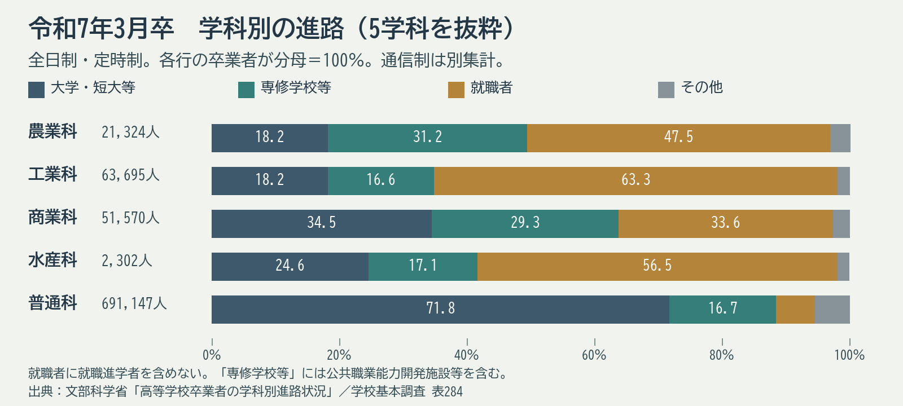

# 第8回 卒業後の進学・仕事・学び直しと大学・大学院

2026年11月5日・本文再点検版。再編案の回番号です。用語と理由の説明、具体例、考える時間の順に読みます。

## 到達目標

- 高校・高専等から大学・大学院や仕事へ進む複数の経路と、課程の目的を区別できる。
- 進路・就労等の統計の範囲と、学ぶ内容・働く条件で追加確認することを説明できる。

## 言葉を使って確かめる

**卒業時の進路とその先**　高校卒業時の進路表に「就職」とあります。その人が後に大学で学ぶかも分かりますか。

**答え**　表が示すのは卒業時点の進路です。その後の進学や学び直しは、別の時点の情報です。

## 大学と大学院で何を学ぶか

大学の学士課程、大学院の修士・博士課程、専門職大学院は、学ぶ目的と修了に必要な内容が異なります。高専本科卒業の準学士は称号で、学士は学位です。高専専攻科等を経て所定の要件と審査により学士を得る経路もあります。名称だけを並べず、課程、取得する資格、次の入学条件を組にして読みます。[NIC-Japan 高等教育資格、資格一覧と各資格の要件](https://www.nicjp.niad.ac.jp/japanese-system/qualification.html)

教育学部にも教員養成を主な目的とする課程と、教育を広く研究・支援する課程があり、学部名だけから卒業要件や免許取得を判断できません。教職大学院には教育実践を専門的に学ぶ目的があります。研究を重視する課程にも実践を対象とする研究があり、実践を重視する課程にも調査・分析が必要です。各大学の教育目的と授業・実習・研究の配置を比べます。

教育学では社会学的調査、心理学的実験、観察、歴史研究、哲学的検討などを使います。学んできた方法を振り返る際は、「何を問い、どんな資料を使い、どこまで説明できるか」を確かめます。卒業時の進路統計はその後の学び直しを追跡したものではないため、働きながら学ぶ経路は別の制度案内で確認します。

## 卒業時の進路とその先の経路

学科別の進路表は、特定年度の卒業者が卒業時にどの区分へ進んだかを示します。進学、就職、その後の離職や学び直しは、観測する時点と対象が異なります。表の範囲を確認して説明します。

高専の専攻科や大学への編入、大学・大学院へ進む経路には、それぞれ出願条件があります。経路図から候補を見つけ、実際に学べる内容や学位・称号は当該課程の案内で確かめます。

| 見る資料 | 説明できること |
|---|---|
| 学科別進路表 | 卒業時点の進学や就職の割合 |
| 入試・編入案内 | 出願条件、選抜、受入年次 |
| 高等教育資格の資料 | 学位・称号と課程の関係 |

## 図の読み取り

令和7年3月卒の学科別進路。分母は各学科の卒業者。例として工業科の就職者は63.3％、普通科は6.1％。就職者には就職進学者を含めない。

| 学科 | 卒業者数 | 大学・短大等 | 専修学校等 | 就職者 | その他 |
|---|---:|---:|---:|---:|---:|
| 農業科 | 21,324 | 18.2％ | 31.2％ | 47.5％ | 3.1％ |
| 工業科 | 63,695 | 18.2％ | 16.6％ | 63.3％ | 1.9％ |
| 商業科 | 51,570 | 34.5％ | 29.3％ | 33.6％ | 2.6％ |
| 水産科 | 2,302 | 24.6％ | 17.1％ | 56.5％ | 1.8％ |
| 普通科 | 691,147 | 71.8％ | 16.7％ | 6.1％ | 5.4％ |

専修学校等には公共職業能力開発施設等を含みます。この集計は全日制・定時制の卒業者を対象とし、通信制の卒業者を含めた値としては扱いません。

## 考える時間

本文の進路表から工業科の卒業年と進学区分の割合を示し、高専本科の準学士と大学の学士の違い、次に調べる条件を短く整理します。

**説明例**　2025年3月卒の工業科では大学・短大等18.2％、専修学校等16.6％です。準学士は称号、学士は学位です。希望する大学への編入の出願条件と受入年次は、その大学の募集要項で確認します。

提出不要のメモです。架空例または公開資料で取り組めます。

## 参考文献・資料

- 令和7年3月卒。学科別に卒業時の進学・就職等を集計。 [文部科学省 高等学校卒業者の学科別進路状況](https://www.mext.go.jp/a_menu/shotou/shinkou/genjyo/021203.htm)
- 大学・大学院の課程と、学士・修士・博士・専門職学位、称号の区別。 [NIC-Japan 高等教育資格](https://www.nicjp.niad.ac.jp/japanese-system/qualification.html)
- 雇用保険の届出を使った就職者・離職者の集計範囲。 [厚生労働省 離職率の集計の考え方](https://www.mhlw.go.jp/stf/seisakunitsuite/bunya/0000137940.html)

[詳しい説明原稿](../ii-08-explanation.md)

[各回の教材一覧](README.md)／[現行教材との対応と更新状況](../../../docs/lesson-quality-review.md)
