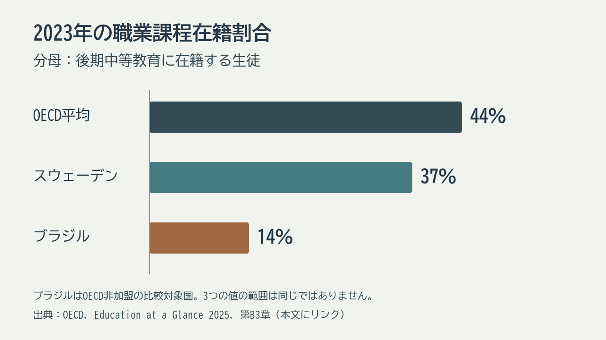

# 第11回 OECDから学ぶ国際比較の基礎

2026年11月5日・本文再点検版。再編案の回番号です。用語と理由の説明、具体例、考える時間の順に読みます。

## 到達目標

- OECDの役割と、加盟国・報告書の対象国・世界全体の違いを説明できる。
- 教育段階、VET、在籍者・卒業者、年齢、基準年等を確かめて比較図を読める。
- OECDの実際の図表で、数値の分母と掲載国の範囲を確認し、比較から言えることの限界を説明できる。

## 言葉を使って確かめる

**比率と比較対象**　二つの国で職業教育の割合が示されています。数字の大小を見る前に何をそろえますか。

**答え**　どの教育段階の誰を分母にし、何を職業教育として数えたかを確認します。

## OECDと教育段階の基礎

OECDは経済協力開発機構で、各国が政策に関する資料・データ・知見を共有し検討する国際機関です。教育も比較の対象になります。OECD加盟国、個々の報告書の掲載国、世界全体は範囲が異なります。図の見出しがOECDでも、全加盟国の数値がそろっているとは限りません。[OECD About](https://www.oecd.org/en/about.html)

VETはVocational Education and Trainingの略で、職業教育・訓練を指します。学校で学ぶものと職場で学ぶもの、その組合せがあり、日本の工業高校だけに対応する語ではありません。初等教育、前期中等教育、後期中等教育、高等教育という段階を確認すると、国ごとに違う学校名を比較しやすくなります。

架空例の単純平均は（20％＋60％）÷2＝40％で、国を同じ重みで扱います。人数を合算した割合は（20＋180）÷（100＋300）×100＝50％で、二国の在籍者全体を分母にします。どちらも計算は正しく、答えている問いが違います。実際のOECDの図では、平均の定義、対象段階、年、欠測を注記で確認します。

## 国際比較の分母と教育段階

架空のA国は後期中等教育の在籍者100人のうち職業課程20人、B国は300人のうち180人とします。割合は20％と60％です。比較には、在籍・卒業の別、教育段階、基準年をそろえる必要があります。

二つの割合の単純平均は40％、二国を一つの集団として数えると50％です。同じ表から得た値でも意味が異なります。実際のOECDの表では、集計方法や欠測の扱いを注記で確認します。

| 架空の集計 | 割合 |
|---|---|
| A国　20人／100人 | 20％ |
| B国　180人／300人 | 60％ |
| 単純平均／人数を合算した割合 | 40％／50％ |

## OECDの実際の統計を読む

次の図は、OECD『Education at a Glance 2025』第B3章の記述をもとに作成しました。2023年の「後期中等教育に在籍する生徒のうち職業課程に在籍する割合」です。分母は15～19歳の全人口でも、高校卒業者でもありません。OECD平均は44％、スウェーデンは37％、ブラジルは14％です。ブラジルはOECD加盟国ではなく、報告書に掲載された比較対象国です。スウェーデンの割合は2013年の47％から2023年の37％に下がりましたが、OECDは課程の分類変更も理由の一つと説明しています。割合の変化だけで、生徒の意欲が下がったとは言えません。

OECD平均は、掲載国を一つの大きな学校に見立てて全在籍者を足した割合とは異なります。また「OECD平均」だけでは、どの国に数値があるかは分かりません。元の表 B3.2 と注記で、欠測を表す `m`、該当なしを表す `a`、基準年の例外を確認します。この図の3本には、OECD平均・加盟国・非加盟の比較対象という、異なる範囲の値が含まれます。日本の工業高校の割合と直接並べる際も、学校基本調査の「学科」とOECDの「職業課程」は分類が一致するとは限らないため、定義を先に調べます。

| 図の値 | 2023年 | 読むときの注意 |
|---|---:|---|
| OECD平均 | 44％ | 国を平均する指標。世界平均ではない |
| スウェーデン | 37％ | 加盟国。分類変更も経年変化に影響 |
| ブラジル | 14％ | 非加盟の比較対象国 |

## 考える時間

架空例の40％と50％について、式と「何を同じ重みで数えるか」を説明します。OECD加盟国と報告書の掲載国の違いも一文添えます。

**説明例**　（20＋60）÷2＝40％は二国を同じ重みで扱う平均です。（20＋180）÷（100＋300）×100＝50％は在籍者を合算した割合です。報告書は一部の加盟国や非加盟国を対象にする場合があり、掲載国の範囲を確認します。

提出不要のメモです。架空例または公開資料で取り組めます。

## 参考文献・資料

- 経済協力開発機構とは何か。政策に関する知見・データ・対話を提供する国際機関という入口。 [OECD About: Better policies for better lives](https://www.oecd.org/en/about.html)
- VETの学ぶ場と役割の概要。掲載する比率は基準年と原表を確認して採用する。 [OECD Vocational education and training (VET)](https://www.oecd.org/en/topics/vocational-education-and-training-vet.html)
- 平均・欠測・教育段階の注記。 [OECD Education at a Glance 2026 読み方](https://www.oecd.org/en/publications/education-at-a-glance-2026_b4968bbc-en/full-report/readers-guide_9d408eac.html)
- 実際の割合と表 B3.2、基準年・欠測の注記。 [OECD Education at a Glance 2025 第B3章](https://www.oecd.org/en/publications/education-at-a-glance-2025_1c0d9c79-en/full-report/how-do-upper-secondary-and-post-secondary-non-tertiary-education-systems-support-students-progression-to-tertiary-education_eb8de986.html)

[詳しい説明原稿](../ii-11-explanation.md)

[各回の教材一覧](README.md)／[現行教材との対応と更新状況](../../../docs/lesson-quality-review.md)

[本編スライド・学生用ガイド・動画](../main/11/README.md)
