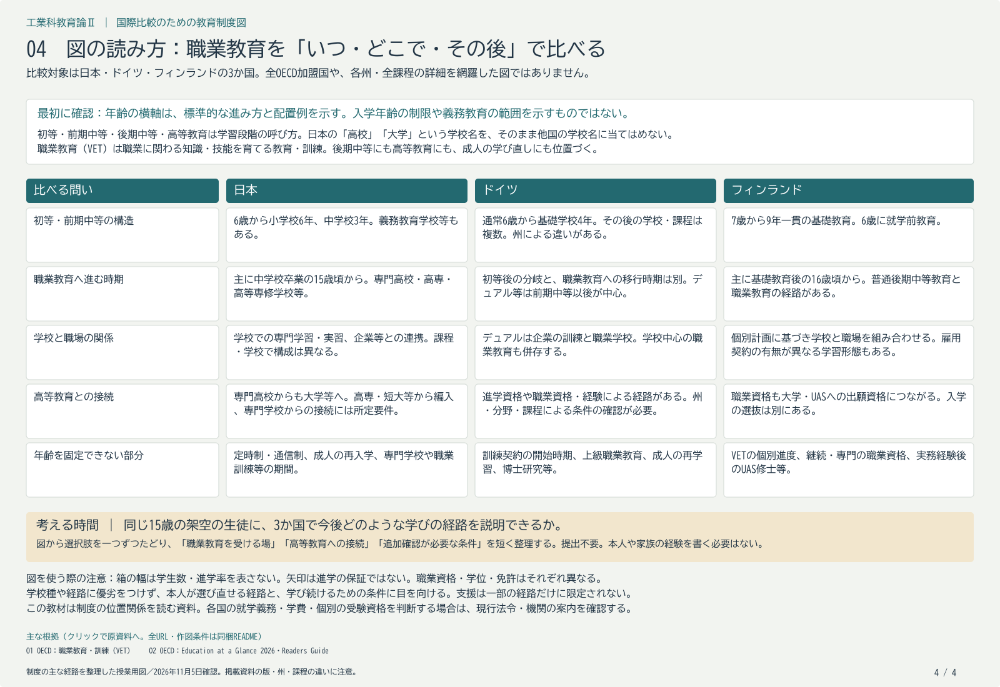

# 第12回 各国の職業教育と学校・企業・資格

2026年11月5日・本文再点検版。再編案の回番号です。用語と理由の説明、具体例、考える時間の順に読みます。

## 到達目標

- 日本と二つ程度の国の事例を、学ぶ場・資格・次の経路等の共通の軸で比べられる。
- 国の内部にも複数の経路があることを踏まえ、日本で考える際の条件を示せる。

## 制度図から学ぶ場と進路を比較する

制度図の横軸は標準的な年齢の位置を示します。同じ年齢の縦線で見ると、どの学校段階で職業教育へ進むかが比較できます。ただし留年、入学時期の違い、成人の学び直しなどで年齢には幅があるため、図の年齢を在籍条件そのものとは読まないようにします。

ドイツのデュアル職業訓練では、企業と職業学校での学習が結び付きます。日本の短期間の職場体験と比較する際は、契約、学ぶ期間、資格評価、企業の役割の違いを確かめます。ドイツにも学校を中心とする経路があり、一つの型で国全体を説明しません。フィンランドでは既に身に付けた能力の確認と個別の計画、職場での学習をどう組み合わせるかに注目できます。

日本で参考にするなら、「職場で学ぶ時間を増やす」という外形だけでなく、受入先の指導者、学校との役割分担、学習を評価する基準、次の進学の条件まで検討します。制度を紹介する資料と、その制度によって成果が上がったと示す研究は区別します。比較の目的は順位を付けることより、制度を支える条件を発見することにあります。

## 年齢の縦線を読む前に、箱の意味を確認する

この授業の制度図は、共通の6～30歳の目盛りに主な経路を配置したものです。箱の幅は人数や人気を示しません。破線の箱は、期間・開始年齢が変わる課程や配置例です。30歳は学べる上限ではなく、図に描いた範囲の終わりです。年齢は経路を見渡す手掛かりで、個人の進度の遅速を判定する物差しではありません。

例えばドイツ図の10歳頃にある分岐は、通常4年の基礎学校から次の学校段階へ進む位置です。企業での職業訓練を10歳から始めるという意味ではありません。ベルリン・ブランデンブルクでは基礎学校が6年で、州差もあります。[KMK 初等教育、4.1／印刷85頁・PDF3頁](https://www.kmk.org/fileadmin/Dateien/pdf/Eurydice/EN/primary_education.pdf#page=3)

フィンランドの図は、7歳から9年間の基礎教育、その後の普通教育・職業教育という経路を示します。日本の小学校6年・中学校3年と、初等・前期中等段階を一体的に設ける仕組みを比較できます。ただし、学校段階が一体であることから、全員が同じ指導や進路選択を受けるとは読み取りません。[OPH 基礎教育の説明](https://www.oph.fi/en/education-system/basic-education)

## 「企業でも学ぶ」の中身を比較する

ドイツのデュアル職業訓練では、企業との訓練契約の下で、企業と職業学校の二つの場で学びます。BIBBの説明では、職種により通常2～3.5年で、終わりに職業団体等の会議所による試験があります。訓練生は企業の従業員であると同時に学校で学ぶ立場でもあります。[BIBB「What does dual training mean?」](https://www.bibb.de/en/77203.php)

したがって、日本の短い職場体験を延長することと、デュアル型の資格取得経路を設けることは同じではありません。誰と契約するか、誰が継続的に指導するか、何を身に付けたと評価するかまで比較する必要があります。ドイツにも学校中心の職業教育等があるため、デュアル制度だけを国全体の唯一の経路としません。

フィンランドでは、既に身に付けた能力を認定し、これから必要な能力を個別の計画に位置付ける仕組みに注目します。「自由に好きなことだけ学ぶ」という意味ではなく、資格に必要な能力との対応を確かめる仕組みです。学校・職場での学びを組み合わせることと、全員の学習期間を同じにすることを分けて考えます。[OPH・教育文化省の制度説明冊子](https://www.oph.fi/en/statistics-and-publications/publications/finnish-vet-nutshell)

| 比較の軸 | 日本の工業高校 | ドイツのデュアル職業訓練 | フィンランドのVET |
|---|---|---|---|
| 学ぶ場 | 学校の一般・専門科目、実習。企業との連携もある | 企業と職業学校 | 教育機関と職場での学びを組み合わせる |
| 何を確認するか | 履修・単位認定、卒業要件 | 訓練契約、訓練内容、修了時の試験 | 資格に必要な能力、既習の認定、個別計画 |
| 次の学習へ | 希望先の出願資格・選抜・編入等の条件 | 得られる資格と州・希望課程の入学条件 | 職業資格による高等教育への出願資格と、希望先の選抜 |

これは三つの比較対象を同じ軸に置いた説明表です。各国内の全課程をまとめた表でも、資格の同等性を認定した表でもありません。外国語の名称を暗記する必要はありません。

## 出願できることと、入学が決まることを分ける

フィンランドの職業資格は高等教育への出願資格につながりますが、その資格を得れば希望する大学へ自動的に入れる、という意味ではありません。制度図の接続は、選抜・分野・課程の条件と一緒に読みます。[OPH 職業教育・訓練](https://www.oph.fi/en/education-system/vocational-education-and-training)

また、フィンランド図のUAS（応用科学大学）の学士の後には、関連する実務経験を経てUAS修士へ進む例が描かれています。大学の学士から修士へ進む箱と、同じ年齢の位置にそろえるだけでは、必要な実務経験が見えなくなります。[OPH 教育制度図（2026）、Work experience 2 years](https://www.oph.fi/sites/default/files/documents/32867828_OPH_Education_system_in_Finland_mustavalk_04_02_2026c.pdf)

「職業教育を選ぶとその後の学習が閉ざされる」という一律の説明を避ける一方、進学経路があることを無条件の進学保証に変えないことが大切です。中学校段階で伝えるなら、「その先にも経路がある。資格と希望先の条件を一緒に調べよう」という説明になります。

## 図の読み取り

日本、ドイツ、フィンランドを、初等・前期中等の構造、職業教育への移行、学ぶ場所、進学との接続、年齢の幅で比べる表。

[各国の制度図と出典](../international-systems/README.md)

## 考える時間

「ドイツでは10歳から企業で職業訓練を始める」「フィンランドでは職業資格を得れば希望する大学に自動的に入れる」という架空の説明を、制度図と本文に照らして一文ずつ直します。

**説明例**　ドイツ図の10歳頃の分岐は通常4年の基礎学校後の学校段階の分岐で、企業での職業訓練の開始とは別です。フィンランドの職業資格は高等教育への出願資格につながりますが、希望先の選抜・入学条件を確認します。

提出不要のメモです。架空例または公開資料で取り組めます。

## 参考文献・資料

確認日：2026年11月5日。本文中のKMK・BIBB・OPHのリンクを今回の焦点の根拠とします。OECDの比較報告は補足資料です。

- 教育制度での位置、評価、職場での学習、運営・費用等の比較軸。報告書の対象国をOECD加盟国一覧と同一視しない。 [OECD (2025) Vocational Education and Training Systems in Nine Countries](https://www.oecd.org/en/publications/vocational-education-and-training-systems-in-nine-countries_1a86eb6c-en.html)
- 企業と職業学校による学び、資格・評価・運営を読む比較候補。同じ国内の学校中心の経路も含め、一つの型で国全体を説明しない。 [OECD (2025) Vocational education and training in Germany](https://www.oecd.org/en/publications/vocational-education-and-training-systems-in-nine-countries_1a86eb6c-en/full-report/vocational-education-and-training-in-germany_dae78944.html)
- 能力を示す評価と学校・職場の役割を読む比較候補。制度の条件を確かめ、優劣の順位へ置き換えない。 [OECD (2025) Vocational education and training in Finland](https://www.oecd.org/en/publications/vocational-education-and-training-systems-in-nine-countries_1a86eb6c-en/full-report/vocational-education-and-training-in-finland_4d8133c3.html)
- 6〜30歳の目盛りと学習段階。図中の年齢・期間の注記。 [日本・ドイツ・フィンランドの制度図](https://github.com/zooc-14calbp/industrial-education-ii/blob/main/reorganized/20261105/international-systems/education-systems-age-vet.pdf)

[詳しい説明原稿](../ii-12-explanation.md)

[各回の教材一覧](README.md)／[現行教材との対応と更新状況](../../../docs/lesson-quality-review.md)
